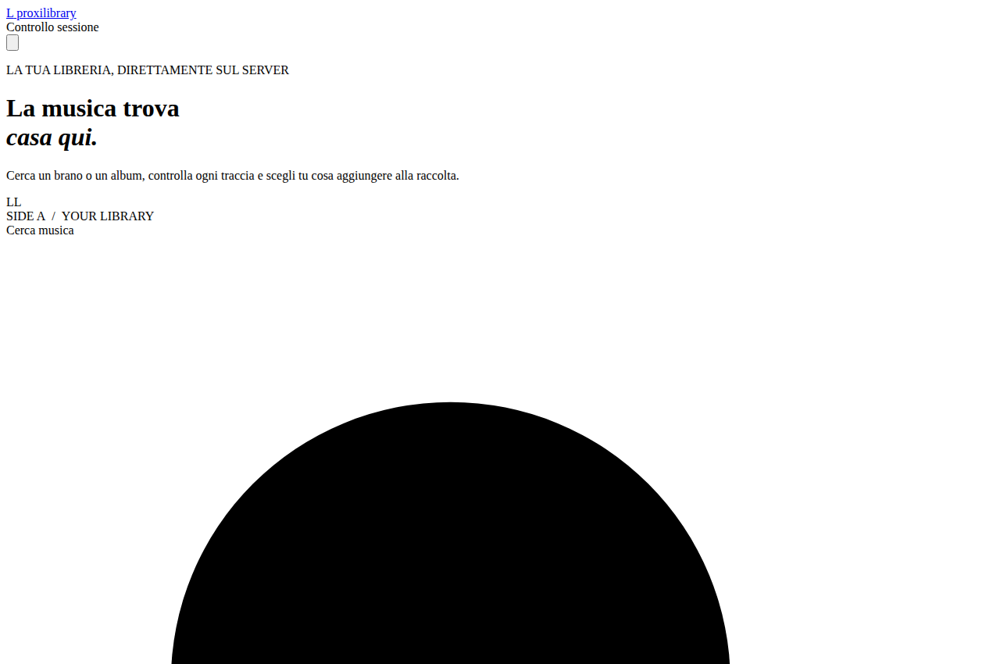
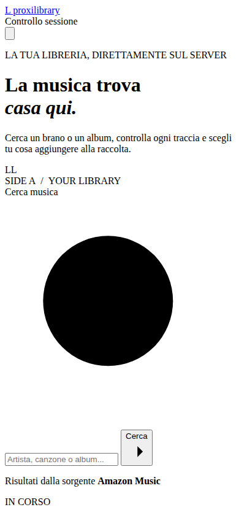

# 🎵 Proxi Library

**Proxi Library** is a modern, clean, and responsive web dashboard designed to search and download music directly to your home server or NAS (such as **ZimaOS** or any **Docker** host), eliminating the need to manually transfer songs from your phone or PC.

The application verifies track availability, displays high-resolution cover art, lets you inspect and select individual tracks from albums with an explicit confirmation step before downloading, and automatically organizes downloaded audio files into a neat directory structure:
```text
music/
└── Artists/
    └── <Artist Name>/
        └── <Album Title>/
            ├── 01 - Track Title.flac
            ├── 02 - Track Title.flac
            └── cover.jpg
```

---

## 📸 Dashboard Preview

The dashboard features an aesthetic lilac-to-pink gradient theme, fully optimized for both desktop and mobile devices:

<p align="center">
  
</p>

<p align="center">
  
</p>

---

## ⚡ Key Features

- **Smart Search & Track Preview**: Search for songs or albums. Before downloading, you can open an in-depth preview, inspect all tracks, and choose whether to grab the entire album or just selected tracks.
- **Download Confirmation**: A dedicated confirmation dialog ensures no accidental downloads are triggered.
- **Artwork & Metadata**: Automatic high-resolution album artwork fetching via public catalog endpoints (Apple iTunes Search and Deezer with fallback), proxied through a secure same-origin backend endpoint.
- **High-Quality Audio & Deduplication**: Downloads files at the highest original source quality with built-in deduplication (previously downloaded tracks are skipped automatically).
- **Real-Time Progress Tracking**: Live progress bars displaying individual track download states and percentages.
- **Recent Downloads History**: Quick access on the home screen to the latest 12 downloaded items with metadata and artwork.
- **Multiple Services & Custom Destination**: Supports Amazon Music (default), Qobuz, and GrilledCheese, with configurable subfolder destinations under the library root via the settings modal.

---

## 🛠️ Search and Download Engine

The backend search resolution and audio download pipeline is powered by the open-source library **[lucidadl](https://github.com/Jude-A/lucidadl)** by Jude-A.

> **Access Note:** Accessing `lucida.to` requires a browser session protected by Cloudflare clearance, handled headlessly inside the container via Chromium and Xvfb. From the dashboard settings (the gear icon ⚙️ in the top right), click **Prepara** under the *Sessione lucida.to* section to initialize or renew the session when needed.

---

## 🚀 Installation & Deployment

### 1. Installation on ZimaOS Server (Recommended)

ZimaOS natively supports custom deployments using Docker Compose through its built-in App Store interface:

1. Open your **ZimaOS** Web UI dashboard.
2. Navigate to **App Store** and click on **Custom Install** (the manual install/import button in the top right corner).
3. Paste the following configuration (also available in `compose.zimaos.yaml`):

```yaml
name: proxi-library
services:
  proxi-library:
    image: ghcr.io/sx273/proxi-library:latest
    container_name: proxi-library
    restart: unless-stopped
    shm_size: "512m"
    ports:
      - "6067:6067"
    environment:
      LUCIDADL_HOME: /data/lucidadl
      DASHBOARD_DATA: /data/dashboard
      MUSIC_ROOT: /music
    volumes:
      - /DATA/Media/Music:/music
      - /DATA/AppData/proxi-library:/data

x-casaos:
  architectures:
    - amd64
    - arm64
  main: proxi-library
  port_map: "6067"
  scheme: http
  index: /
  title:
    en_US: Proxi Library
  tagline:
    en_US: Music search and download dashboard
  category: Media
```

> 💡 **Path Mapping Tip:** Make sure `/DATA/Media/Music` matches the actual music folder on your ZimaOS storage pool. The `/DATA/AppData/proxi-library` directory persists your database, preferences, and browser session state across updates.

4. Click **Install**.
5. Once the container is running, click the **Proxi Library** app card or navigate to `http://<SERVER-IP>:6067`.
6. Open the settings modal (top-right gear icon) and click **Prepara** under *Sessione lucida.to*.

---

### 2. Standard Docker Compose Installation

If you are running any Linux server, PC, or Raspberry Pi with Docker and Docker Compose installed:

1. Clone the repository:
   ```bash
   git clone https://github.com/sx273/proxi-library.git
   cd proxi-library
   ```

2. Configure environment variables (optional):
   ```bash
   cp .env.example .env
   ```
   In `.env`, you can customize your music storage path (`MUSIC_LIBRARY_PATH`) and data directory (`APP_DATA_PATH`), or stick with the local default `./music` and `./app-data` folders.

3. Start the application:
   ```bash
   docker compose up -d
   ```
   *(Or run `docker compose up -d --build` if you prefer to build the image locally from source)*.

4. Open your browser and visit:
   ```text
   http://localhost:6067
   ```
   *(Replace `localhost` with your server's IP address if accessing remotely)*.

---

## ⚠️ Maintenance & Forks

This project was developed for a specific personal use case. **I do not guarantee continuous maintenance, long-term updates, or active adaptation** to future breaking changes in upstream third-party service APIs.

You are welcome to:
- Create a **[Fork](https://github.com/sx273/proxi-library/fork)** of this repository.
- Modify, adapt, and improve the codebase to suit your needs.
- Publish your own independent version of the project.

---

## ⚖️ Legal Disclaimer

Use this application solely for music and media you are legally entitled and authorized to download, in full compliance with applicable laws and the terms of service of the respective platforms. This project is not affiliated with, endorsed by, or associated with any commercial streaming service.
